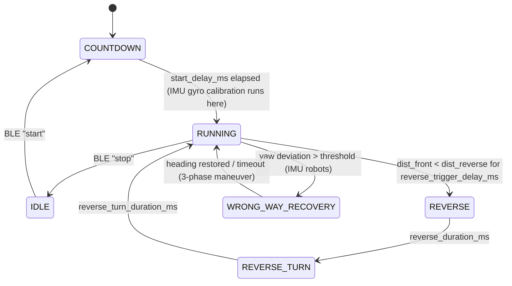

# AGENTS.md

Guidance for AI agents and contributors working in this repository.

## Overview

Firmware for a team of autonomous **folkrace** robots (small RC-style cars that race around a walled track and must avoid walls/other cars). Everything runs on **ESP32-family** MCUs using the **Arduino framework** under **PlatformIO**. Each robot is its own PlatformIO project; common code lives in `shared/` and is consumed as a local library.

## Repository layout

```
folkrace/
├── shared/                 # Common PlatformIO library ("folkrace")
│   ├── library.json
│   ├── include/esp32_bmi088_fix.h   # Force-included to fix OPEN_DRAIN macro clash with BMI088 lib
│   └── src/
│       ├── state.h          # RobotState, RunningState, TrackDirection, PIDState, IMUState
│       ├── protocol.h       # ESP-NOW packet structs (PacketHeader, TelemetryPacket), RobotId
│       ├── util.h           # message_magic ("FOLK"), broadcast address, ESP-NOW channel (11)
│       ├── ble/             # BLE UART-like command console (ble.*, commands.*)
│       ├── control/         # Header-only: pid.h, slew_rate_limiter.h, ema.h
│       ├── driver/          # ESC, Servo, RZ7886Driver (H-bridge), BMI088Driver (IMU)
│       └── prefs/           # NVS persistence of tunables (Preferences, namespace "folkrace")
├── sniegbaltite/           # Robot: ESP32-S3, ESC + servo, BMI088, 3 front + 4 side VL53L0X
├── rosepink/               # Robot: ESP32-S3, ESC + servo, BMI088, 3 front VL53L0X + 2 side VL53L5CX
├── nakts/                  # Robot: ESP32-C3, RZ7886 motor + servo, 3 front VL53L0X (no IMU, no telemetry)
├── banana/                 # Robot: ESP32-C3, differential drive (2× RZ7886), 1 front VL53L0X + 2 Sharp analog IR
└── telemetry-receiver/     # ESP32 dongle: receives ESP-NOW telemetry, prints JSON lines over serial
    └── scripts/read_telemetry.py   # Serial → console + PlotJuggler UDP forwarder
```

Each robot project contains only `platformio.ini`, `src/config.h`, and `src/main.cpp`.

## Build & tooling

- Build/flash from inside a robot directory: `pio run`, `pio run -t upload`, `pio device monitor`.
- Robots use the **pioarduino** platform (`platform-espressif32` stable zip, Arduino core 3.x — e.g. `ledcAttach`, `rgbLedWrite`, `esp_now_recv_info_t`). `telemetry-receiver` uses stock `espressif32`.
- `lib_extra_dirs = ../shared` pulls in the shared library. Robots with the BMI088 also need:
  ```ini
  build_flags = -I ../shared/include -include esp32_bmi088_fix.h
  ```
- ESP32-S3 boards use `ARDUINO_USB_MODE=1` and `ARDUINO_USB_CDC_ON_BOOT=1` (native USB serial).
- External libs: `pololu/VL53L0X`, `bolderflight/Bolder Flight Systems BMI088`, `sparkfun/SparkFun VL53L5CX` (rosepink only).
- Editor support via clangd: each project has a `.clangd`; `shared/.clangd` points its compilation DB at `../sniegbaltite`. The root `compile_commands.json` is a symlink to sniegbaltite's. Generate with `pio run -t compiledb`.
- There are no unit tests; verification is done on hardware via serial logs, BLE, and telemetry.

## Robot architecture

All robots follow the same single-file structure in `main.cpp`.

### Globals

- `RobotState state = {};` — **must be a non-static global named `state`**; `shared/src/ble/commands.cpp` accesses it via `extern RobotState state;`.
- Hardware objects (`ESC`, `Servo`, `RZ7886Driver`, `VL53L0X`, `BMI088Driver`) are file-level globals.
- Control helpers: `static SlewRateLimiter throttle_limiter / steering_limiter`, optionally `EMAFilter`.
- Module-private runtime variables are `static` (e.g. `countdown_start_ms`, `obstacle_detected`, `prev_running_state`, `reverse_turn_steering`).

### `setup()`

1. `load_robot_prefs(state)` — restore tunables from NVS.
2. Start I²C buses (`Wire` at 400 kHz; S3 robots also `Wire1` for side sensors), `Serial`.
3. Init IMU (if present), actuators, ToF sensors (XSHUT sequencing to assign unique I²C addresses: front `0x30`, right `0x31`, left `0x32`, …).
4. `init_ble("<robot name>")`, `init_espnow()` (broadcast peer on channel 11).
5. Enter `RunningState::COUNTDOWN` (robots auto-start after `config::start_delay_ms`).

### `loop()` — fixed-rate 100 Hz control loop

```cpp
if (now_us - last_loop_us >= loop_interval_us) {
  last_loop_us += loop_interval_us;
  if (now_us - last_loop_us >= loop_interval_us) last_loop_us = now_us; // catch-up guard
  ...
}
```

`delta_time` is the constant `0.01f` s, passed to PID / slew limiters. Inside each tick, in order:

1. **Sense** — IMU update, non-blocking ToF reads (`is_tof_data_ready` → `tof_read_distance`, clamp to `[sensor_min_raw, sensor_max_raw]`; invalid/error → `sensor_max_raw`). I²C errors trigger re-init (S3 robots do it in a FreeRTOS task on core 0).
2. **Derived signals** — slope detection (pitch vs. `flat_pitch`), yaw progress frontier for wrong-way detection, direction switch.
3. **Edge-triggered transition handling** — compare `state.running_state` with `prev_running_state` and run entry actions (state may be changed externally by BLE commands).
4. **State machine** (`switch (state.running_state)`), writing `state.target_throttle` / `state.target_steering` in normalized `[-1, 1]`.
5. **Actuate** (when not `IDLE`) — slew-limit targets into `current_*`, map steering to servo degrees (`servo_deg_left/middle/right`) or differential mix (banana), write motors.
6. **Telemetry** — 30 Hz ESP-NOW broadcast via `send_telemetry()` (or periodic `Serial.printf` debug on C3 robots).

### State machine (`RunningState`)



- `IDLE`: motors stopped, servo centered, all filters/PIDs reset on entry.
- `RUNNING` steering: blend of lateral centering (`dist_right - dist_left`), side-sensor centering/angle alignment, emergency wall repulsion (`side_danger_dist`), and front corner anticipation (`front_urgency` between `front_turn_dist` and `front_critical_dist`). The result is the PID error (+ `steering_pid.offset` trim) → `update_pid()`.
- `RUNNING` throttle: `base_throttle`, or `straight_throttle` when `dist_front > dist_far` (and not on a slope); reduced in corners.
- `WRONG_WAY_RECOVERY` exists only on IMU robots (sniegbaltite, rosepink); other robots have an empty case.
- Sign convention: **positive steering = right**, **positive throttle = forward**.
- Track direction (`CLOCKWISE` / `COUNTER_CLOCKWISE`) comes from a toggle switch on S3 robots and decides the reverse-turn direction and yaw progress sign.

### Per-robot differences

| Robot | MCU | Drive | Steering | Sensors | IMU | Telemetry |
|---|---|---|---|---|---|---|
| sniegbaltite | ESP32-S3 | `ESC` | `Servo` | 3× VL53L0X (Wire) + 4× VL53L0X side (Wire1) | BMI088 | ESP-NOW |
| rosepink (BLE name `roze`) | ESP32-S3 | `ESC` | `Servo` | 3× VL53L0X + 2× VL53L5CX 4×4 side (wall distance + heading fit) | BMI088 | ESP-NOW |
| nakts | ESP32-C3 | `RZ7886Driver` | `Servo` | 3× VL53L0X | — | Serial only |
| banana | ESP32-C3 | 2× `RZ7886Driver` (differential) | motor mix | 1× VL53L0X front + 2× Sharp analog IR (higher ADC = closer!) | — | Serial (ESP-NOW disabled via `#if 0`) |

Banana uses its own PD (with `EMAFilter` derivative) instead of `update_pid()`, a motor deadband (`motor_min_throttle`), and clamps the inside wheel to ≥ 0 while `RUNNING`.

## Shared modules

- **`state.h`** — single source of truth for runtime state. Add new enum values together with their `*_to_str()` case.
- **`protocol.h`** — `__attribute__((packed))` structs; header `{magic, type, robot_id, length}` followed by payload. When changing `TelemetryPacket`, update **all** senders (each robot's `send_telemetry()`), `telemetry-receiver/src/main.cpp` JSON printer, and `read_telemetry.py` together. New robots need a `RobotId` + `robot_id_to_str()` entry and entries in the Python `ROBOT_COLORS` / `ROBOT_PORT_OFFSETS`.
- **Telemetry `flags` bits**: 0 = obstacle detected, 1 = BLE connected, 2 = clockwise, 4 = on slope (bit 3 currently unused).
- **`ble/`** — single read/write/notify characteristic. Incoming text is split into `command args` and dispatched through `command_list[]` in `commands.cpp`. Reply with `notify(fmt, ...)` (256-byte buffer, no-op when disconnected). Commands: `start`, `stop`, `state`, `k|pid`, `speed|throt`, `offset|o`, `dist`, `save`, `load`, `help|?`. To add a command: write `void cmd_x(char *args)`, register it in `command_list`, and document it in `cmd_help`.
- **`prefs/`** — persisted tunables: `kp, ki, kd, base_throt, reverse_throt, straight_throt, offset, dist_far, dist_rev`. NVS keys must stay ≤ 15 chars. Adding a tunable means updating both `load_state_from_prefs` and `save_state_to_prefs`.
- **`control/`** — header-only, allocation-free: `update_pid(dt, PIDState&)` (integral clamped to ±1, low-pass derivative, output clamped to ±1), `SlewRateLimiter` (separate accel/decel rates, units/s), `EMAFilter`.
- **`driver/`** — thin LEDC-based wrappers with `init()` / `write(float)` / `stop()`. `write(float)` takes normalized `[-1, 1]`. `bmi088.h` is wrapped in `#if __has_include(<BMI088.h>)` so robots without the lib still compile the shared library.

## Code conventions

### Formatting
- C++ (Arduino/ESP-IDF, GNU++ standard used by the toolchain), 2-space indent, braces on the same line, ~80-column wrapping (clang-format LLVM-like style). Use `// clang-format off/on` for long literal tables.
- Header guards: `#pragma once`.
- Includes: project/shared headers in quotes first (alphabetical, e.g. `"ble/ble.h"`, `"config.h"`, `"control/pid.h"`), then system/library headers in angle brackets.

### Naming
- Functions, variables, struct fields, `constexpr` constants: `snake_case` (`update_pid`, `dist_front`, `loop_interval_us`).
- Types (classes, structs, enums): `PascalCase` (`RobotState`, `SlewRateLimiter`).
- `enum class` values: `UPPER_SNAKE_CASE` (`RunningState::REVERSE_TURN`). Enums have explicit underlying type (`uint8_t`) so they fit in packed packets.
- Class methods: `snake_case` too (`write_microseconds`, `start_calibration`, `is_initialized`). Only overrides of external library callbacks (e.g. BLE `onConnect`, `onWrite`) keep the library's `camelCase` names.
- Private members: `m_` prefix (`m_pin`, `m_alpha`). Class-scope constants: `static constexpr` `UPPER_SNAKE_CASE` (`PWM_FREQ`).
- Unit suffixes on time/distance values: `_ms`, `_us`, `_mm`, `_deg`, `_rad`, `_hz`.
- Free functions in shared modules are prefixed by module when ambiguous (`ble_is_connected`, `ble_send`, `init_ble`, `load_robot_prefs`).
- Log messages use a bracketed tag prefix: `Serial.printf("[TOF] ...\n")`, `[IMU]`, `[BLE]`, `[ESP-NOW]`, `[DIRECTION]`, `[RUN]`.

### `config.h`
- Two namespaces: `config::` (tunable constants, timings, thresholds) and `pin::` (GPIO numbers). All values are `constexpr` with fixed-width types.
- Comment units (`// mm: ...`, `// us: ...`). No magic numbers in `main.cpp` when a config constant makes sense.
- Values that need field tuning without reflashing belong in `RobotState` + prefs + a BLE command, not `config.h`.

### Embedded rules
- No dynamic allocation or `String` in the control loop; use fixed buffers and `snprintf`.
- No blocking calls (`delay`, blocking sensor reads) inside `loop()`; poll data-ready registers. Slow work (sensor re-init, LED blinking, VL53L5CX processing) goes in a FreeRTOS task pinned to **core 0** via `xTaskCreatePinnedToCore`, communicating through `volatile` flags, task notifications, or `portMUX` critical sections.
- Timing uses `uint32_t` `micros()`/`millis()` with unsigned subtraction (`now - start >= interval`) so wraparound is safe. Convert ms config values with `static_cast<uint32_t>(x_ms) * 1000`.
- Normalize control signals to `[-1.0f, 1.0f]` and clamp with `constrain` / `std::clamp`-style min/max. Use `float` literals (`0.0f`).
- Prefer `static_cast<>` over C-style casts.
- Document public shared APIs with `/** ... @param ... @return */` doc comments.
- Robots are developed by copy-and-adapt; when fixing a bug in logic shared across robots (ToF reading, `send_telemetry`, state transitions), check whether the same fix applies to the other `main.cpp` files. Move code into `shared/` when it becomes truly identical.

### Git
- Short, lowercase, imperative commit messages (e.g. `improve tof init handling`, `add rosepink code`).
- Don't commit generated files: `.pio/`, `.cache/`, `compile_commands.json`.
